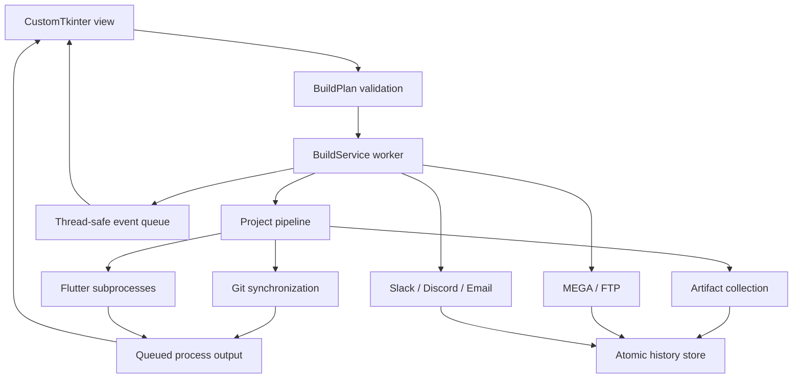

# Application architecture

APK Builder separates the desktop view, build coordination, tool adapters, and persistence. A single coordinator owns a build or artifact cleanup operation at a time.

## View and event loop

`bin/gui.py` owns Tk variables and widgets. Workers publish structured events through `BuildService.events` and write output through `QueueLog`. The main Tk timer drains both queues, updates project status and progress, and restores controls after completion. Search refresh is debounced, and console lines are capped to limit long-session rendering costs.

The Distribution page declares each adapter's toggle and configuration fields. Secret fields use masking based on `utils.settings_utils.SECRET_KEYS`. `collect_settings()` captures them into a build plan before starting execution.

## Coordinator and pipeline

`modules/build_service.py` validates project/format selections, directories, branch input, tool availability, and required integration settings. Slack additionally validates its webhook endpoint. Notification channels currently require an upload provider.

The coordinator applies the captured settings to environment-based adapters and locks UI configuration for the operation. `BuildPlan` is a frozen dataclass; its settings mapping should be treated as read-only by callers. This is a single-coordinator design, not an isolated environment per concurrently running project.

`modules/build_project_module.py` synchronizes a repository, optionally cleans, resolves dependencies, generates enabled localization, builds selected formats, and collects output. It raises failures to the coordinator. The artifact callback records each collected file before the next build or delivery step.

`modules/process_runner.py` streams merged subprocess output, owns the active process handle, and checks cancellation before and after commands. Windows cancellation terminates the active process tree. Network operations use adapter-specific timeouts and cancellation boundaries.

## Slack boundary

`modules/slack_module.py` contains endpoint validation, payload construction, and a single HTTP attempt. `build_payload()` can be tested independently. The adapter does not touch Tk, write history, configure a workspace, or obtain channel credentials. The coordinator persists `slack_notified` and converts an unacknowledged notification into a session warning.

## Persistence and cleanup

`utils/app_paths.py` anchors `settings.json` and `build_history.json` in `%LOCALAPPDATA%\APKBuilder`, independently of the executable location. `utils/settings_utils.py` reads and atomically replaces the user settings file. The source app and executable share the user profile. Legacy `.env` and history beside the app are read only until their respective profile files exist; future writes target the profile and leave legacy files unchanged. Subprocesses use explicit working directories and never change the application cwd.

`utils/history_utils.py` protects in-process history updates with an `RLock` and atomically replaces JSON files. It retains up to 500 records and refuses to silently overwrite malformed history. It is not a multi-process database.

`modules/artifact_service.py` scopes local deletion to APK/AAB files inside the configured output root, cleans tracked MEGA/Discord resources, and retains partial failures for retry. Slack posts and email notifications remain external records; FTP removal is separate.

## Verification and packaging

- `tests/test_build_system.py`: core pipeline, subprocess cancellation, Git preservation, collection, history, and cleanup.
- `tests/test_settings_storage.py`: fresh startup without `.env`, atomic user-profile persistence, legacy migration, cleared values, and executable-location independence.
- `tests/test_slack_integration.py`: mocked Slack HTTP boundary and coordinator outcomes.
- `tests/gui_smoke.py`: real Tk window with isolated settings and a simulated build; it verifies Slack field masking and configuration capture.
- `main.spec`: PyInstaller desktop executable with CustomTkinter assets; credentials and history are excluded.

Run verification commands from the [project README](../README.md). Live repositories, Flutter builds, uploads, and real notifications require separate environment-specific checks.
